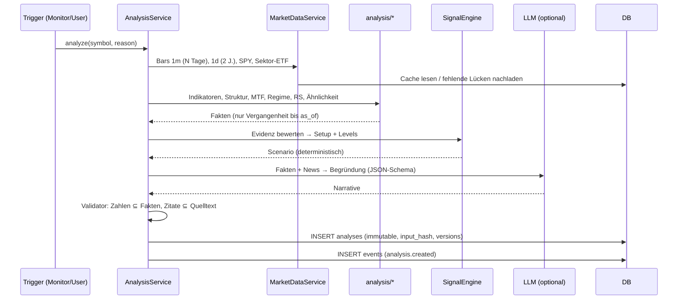

# Architektur

> Grundsatz: **Ein deterministischer Analyse-Kern entscheidet, das LLM erklärt.** Es werden
> keine Orders ausgeführt; es gibt keinen Code-Pfad zu einer Broker-Order-API.

## 1. Systemübersicht

```mermaid
flowchart LR
    subgraph Extern
        ALP[Alpaca Market Data<br/>REST + WebSocket]
        NEWS[Alpaca News / Benzinga]
        SEC[SEC EDGAR]
        LLM[LLM API<br/>Anthropic]
    end

    subgraph Backend [Python Backend – ein Codebase, zwei Prozesse]
        direction TB
        API[FastAPI<br/>REST + /ws]
        WRK[Worker<br/>APScheduler]
        subgraph Core [app/]
            PROV[providers/<br/>MarketData, News, Filings]
            ANA[analysis/<br/>Indikatoren, Struktur, MTF,<br/>Regime, Ähnlichkeit]
            SIG[signals/<br/>Evidenz → Setup → Levels]
            LLMM[llm/<br/>Client, Schemas, Validator]
            SVC[services/<br/>Analyse, Markt, Monitor,<br/>Auswertung]
            BT[backtest/<br/>Walk-Forward Replay]
        end
    end

    DB[(PostgreSQL<br/>bars, analyses (immutable),<br/>news, outcomes, events)]
    FE[Next.js Dashboard<br/>Lightweight Charts]

    ALP --> PROV
    NEWS --> PROV
    SEC --> PROV
    PROV --> SVC
    SVC --> ANA --> SIG --> LLMM --> LLM
    SVC <--> DB
    WRK --> SVC
    API --> SVC
    WRK -- Outbox-Events --> DB
    DB -- Outbox-Tail --> API
    API <-- REST/WebSocket --> FE
```

**Warum zwei Prozesse, aber kein Microservice?** API und Worker nutzen dieselbe Codebasis und
dieselbe Datenbank. Der Worker pollt die Datenquellen, erkennt Trigger und erzeugt Analysen. Die
API liefert Daten aus und pusht Events per WebSocket. Die Verbindung zwischen beiden läuft über
eine **Outbox-Tabelle `events`** in Postgres, die die API alle 2 s ausliest. Redis entfällt damit.
In der lokalen Entwicklung kann der Worker per `RUN_WORKER_IN_API=true` auch im API-Prozess laufen.

## 2. Datenfluss einer Analyse



## 3. Modulstruktur (Backend)

```
backend/app/
├── core/         config (pydantic-settings), logging (JSON), time & sessions (XNYS), errors
├── domain/       Pydantic-Modelle: Bar, Timeframe, Provenance, Scenario, Analysis …
├── providers/    MarketDataProvider-Protokoll; alpaca.py, demo.py; news (alpaca), sec_edgar.py
├── db/           SQLAlchemy-Modelle, Session, Repositories
├── analysis/     indicators, structure, levels, multitimeframe, regime, relative_strength,
│                 similarity (kNN + DTW), features
├── signals/      evidence (Pro/Contra-Faktoren), engine (Setup-Klassifikation, Levels, R:R)
├── llm/          base (LLMClient), anthropic_client, null_client, prompts, schemas, validator
├── news/         Relevanz, Neuheit (Dedupe), Kursreaktion, LLM-Klassifikation
├── services/     market_data, analysis, monitor (Trigger + Dedupe), evaluation, watchlist
├── notifications/ Notifier-Protokoll, InApp-Kanal, Registry (Telegram/Discord/Mail später)
├── backtest/     walk-forward Replay der Engine, Kostenmodell, Baselines, Report
├── workers/      Scheduler-Jobs (idempotent)
└── api/          REST-Router, WebSocket-Hub
```

Regeln für Abhängigkeiten: `analysis` und `signals` sind **reine Funktionen** über
pandas/NumPy, ohne I/O. Dadurch lassen sie sich deterministisch testen und laufen im Backtest
genauso wie live. `services` orchestrieren I/O, `api` ruft nur `services` auf.

## 4. Datenbankmodell

```mermaid
erDiagram
    bars {
        string symbol PK
        string timeframe PK "1Min | 1Day"
        datetime ts PK "UTC, Bar-Beginn"
        string feed PK "iex | sip | demo"
        float open
        float high
        float low
        float close
        float volume
        float vwap
        int trade_count
        string data_kind "live|delayed|historical|demo"
        datetime fetched_at
    }
    watchlist { string symbol PK; string sector_etf; datetime added_at }
    analyses {
        uuid id PK
        string symbol
        datetime created_at
        datetime data_as_of
        string trigger
        string outcome "bullish_setup|...|insufficient_data"
        json scenario
        json facts
        json narrative
        json provenance
        string input_hash
        string engine_version
        string llm_model
        string data_kind
    }
    signal_outcomes {
        uuid analysis_id PK,FK
        int horizon_min PK
        datetime evaluated_at
        float ret
        float mfe
        float mae
        string result "target|stop|open|not_triggered|n_a"
    }
    news_items {
        string id PK "provider:id"
        string provider
        datetime published_at
        string headline
        string url
        json symbols
        string content_hash
        json analysis
    }
    events { bigint id PK; string type; json payload; datetime created_at }
    notifications { bigint id PK; string dedupe_key UK; string severity; string title; json payload; bool read }
    llm_usage { bigint id PK; date day; string model; int input_tokens; int output_tokens; float cost_usd }
    analyses ||--o{ signal_outcomes : "ausgewertet durch"
```

**Unveränderbarkeit:** `analyses` hat in Postgres einen Trigger, der `UPDATE` und `DELETE`
ablehnt (Migration `0001`). Die Auswertung landet ausschließlich in `signal_outcomes`.
`input_hash` ist ein SHA-256 über die kanonisierten Eingabedaten; damit lässt sich jede Analyse
mit derselben `engine_version` reproduzieren.

**Idempotenz:** Bars haben einen zusammengesetzten Primärschlüssel und werden per Upsert
geschrieben. Benachrichtigungen haben einen `dedupe_key` (z. B. `AAPL:breakout:R:189.50:2026-10-24`),
der als UNIQUE-Constraint doppelte Alerts physisch verhindert.

## 5. API-Konzept

| Methode | Pfad | Zweck |
|---|---|---|
| GET | `/api/health` | Status, Datenmodus (live/delayed/demo), Provider, LLM aktiv? |
| GET/POST/DELETE | `/api/watchlist` | Watchlist verwalten |
| GET | `/api/watchlist/overview` | Kurs, %-Änderung, Volumen, RVOL, letztes Signal je Symbol |
| GET | `/api/symbols/{s}/bars?tf=5Min&days=5` | OHLCV + Provenienz |
| GET | `/api/symbols/{s}/indicators?tf=5Min` | Indikatorserien für den Chart |
| POST | `/api/symbols/{s}/analyze` | Analyse auslösen (manuell) |
| GET | `/api/symbols/{s}/analyses/latest` | Letzte Analyse |
| GET | `/api/analyses?symbol=&limit=` | Signal-History inkl. Outcomes |
| GET | `/api/analyses/{id}` | Einzelanalyse (immutable) |
| GET | `/api/symbols/{s}/similar` | Historische Vergleichssituationen |
| GET | `/api/symbols/{s}/news` | Nachrichten + KI-Einordnung |
| GET | `/api/performance` | Auswertung: Engine vs. Baselines |
| GET/POST | `/api/notifications`, `/api/notifications/{id}/read` | In-App-Benachrichtigungen |
| WS | `/ws` | Push: `bar`, `analysis.created`, `notification`, `news` |

Jede Antwort mit Marktdaten enthält einen `provenance`-Block:
`{provider, feed, data_kind, is_realtime, delay_minutes, as_of}`.

## 6. Analysepipeline (deterministisch)

1. **Datenbeschaffung:** 1-Min-Bars der letzten `INTRADAY_LOOKBACK_DAYS` (Standard 60
   Handelstage) inkl. Extended Hours, Tagesbars 2 Jahre, dazu SPY und der Sektor-ETF.
2. **Datenqualität:** Lückenprüfung gegen den XNYS-Kalender, Zeitstempel-Monotonie, OHLC-
   Konsistenz (`low ≤ open,close ≤ high`), Staleness (letzter Bar älter als erwartet?). Ergebnis
   ist ein `data_quality`-Block. Bei schweren Mängeln lautet das Ergebnis `insufficient_data`.
3. **Multi-Timeframe:** Aus 1-Min-Bars werden 5m/15m/1h (Session-ausgerichtet) gebildet, aus
   Tagesbars die Wochenbars. Pro Timeframe: Trend (EMA20/50-Lage + Steigung + Swing-Struktur
   HH/HL vs. LH/LL), RSI, MACD-Histogramm, ATR.
4. **Levels:** Swing-Hochs/-Tiefs aus 1h und Tageschart werden per ATR-Toleranz zu Zonen
   geclustert und nach Berührungen gewichtet. Dazu kommen PDH/PDL/PDC, Pre-Market-High/Low,
   Tageseröffnung und VWAP.
5. **Ereignisse:** Gap (vs. Vortagesschluss), Breakout/Breakdown durch Zone mit Volumen-
   bestätigung (RVOL ≥ 1,5), False Breakout (Durchbruch, danach Schluss wieder innerhalb der Zone),
   Momentumverlust (Preis-Hoch ohne RSI-Hoch), Überdehnung (Abstand zum VWAP in ATR).
6. **Kontext:** Relative Stärke vs. SPY und Sektor-ETF (Rendite-Differenz seit Eröffnung und über
   5 Tage), Volatilitätsregime (ATR-Perzentil über 1 Jahr), Marktphase (Pre/Regular/After).
7. **Historische Ähnlichkeit** (siehe 7).
8. **Signal-Engine:** Evidenzfaktoren (jeweils mit Richtung, Gewicht und Klartext). Daraus folgt
   die Setup-Klasse; Entry-Zone, Stop (Struktur ± ATR-Puffer), Ziele (nächste Zonen) und R:R. Liegt
   R:R unter 1,5, die Datenqualität unter dem Mindestmaß oder gibt es einen starken MTF-Konflikt,
   lautet das Ergebnis „Beobachten“ bzw. „Kein Trade“.
9. **LLM-Synthese** (optional) + Validierung → Persistenz.

Die Setup-Klassen sind `bullish_setup`, `bearish_setup`, `long_entry`, `short_entry`,
`invalidated`, `watch`, `no_trade` und `insufficient_data`.

**Konfidenz:** Es gibt **keinen frei erfundenen Konfidenzwert**. Die Engine liefert eine
transparente *Evidenzbilanz* (Summe gewichteter Pro-/Contra-Faktoren), ausdrücklich gekennzeichnet
als „nicht kalibriert, keine Wahrscheinlichkeit“. Eine kalibrierte Trefferquote wird erst angezeigt,
wenn für den jeweiligen Evidenz-Bucket mindestens `CALIBRATION_MIN_SAMPLES` (Standard 50) **live
erzeugte und nachträglich ausgewertete** Analysen vorliegen. Diese Daten sind out-of-sample, weil
die Analysen vor dem Ergebnis gespeichert wurden.

## 7. Historische Mustererkennung

* **Merkmalsvektor** zum Zeitpunkt *t*, nur aus Bars ≤ *t*: Renditen über 5/15/30/60 Min.
  normiert auf ATR, Abstand zum VWAP in ATR, RVOL (gleiche Tageszeit, 20 Tage), realisierte
  Volatilität (Perzentil), EMA-Steigung, Position in der Tagesrange, Gap, Minuten seit Eröffnung.
* **Kandidaten:** alle 5-Min-Zeitpunkte früherer Handelstage mit ähnlicher Tageszeit (±30 Min.),
  optional gleichem Volatilitätsregime. **Embargo:** Der aktuelle Tag und der Vortag sind
  ausgeschlossen, damit sich Lookback- und Outcome-Fenster nicht überlappen.
* **Suche:** Robust-Skalierung (Median/IQR), die **nur auf den Kandidaten** gefittet wird, dann
  kNN (euklidisch). Optional werden die Top-k per DTW auf der normierten 60-Min-Kursform neu
  sortiert.
* **Outcome-Statistik:** Vorwärtsrendite nach 5/15/30/60 Min. (gleiche Session), MFE/MAE innerhalb
  von 60 Min., Trefferquote mit **Wilson-Konfidenzintervall**, Vergleich mit der **unbedingten
  Basisrate** derselben Kandidatenmenge. Als Wahrscheinlichkeit wird das nur angezeigt, wenn
  n ≥ 30, die Ähnlichkeitsdistanz unter einer Schwelle liegt und das KI-Intervall die Basisrate
  nicht enthält. Sonst ist das Ergebnis als „deskriptiv, nicht signifikant“ gekennzeichnet.
* **Bias-Schutz:** kein Look-Ahead (Merkmale nur aus Vergangenheit, Test vorhanden), adjustierte
  Kurse (`adjustment=all`), Survivorship-Bias ist im Einzelsymbol-MVP gering. Beim späteren
  Screening braucht es ein Universum inkl. delisteter Titel (Roadmap).

## 8. News-Pipeline

1. Abruf (Alpaca News, SEC-Filings) → Dedupe per Provider-ID **und** Content-Hash (Headline
   normalisiert), damit Syndizierungen erkannt werden.
2. Neuheit: Gab es in den letzten 72 h eine Meldung mit hoher Headline-Ähnlichkeit
   (Jaccard über Tokens)? Wenn ja, wird sie als „nicht neu“ markiert.
3. Kursreaktion (deterministisch): Rendite und RVOL in den 5/15/30 Min. nach `published_at`,
   relativ zu SPY. Die Reaktion kommt aus den Daten, nicht vom LLM.
4. LLM-Klassifikation (optional): Kategorie, Richtung, betroffene Ticker (müssen in den
   Metadaten stehen), **wörtliche** Faktenzitate (Substring-Prüfung). Nicht bestandene
   Validierung → verworfen + geloggt.

## 9. Monitoring, Trigger & Benachrichtigungen

Der Worker prüft jede Minute (konfigurierbar) für jedes Watchlist-Symbol:

| Trigger | Bedingung | Dedupe-Schlüssel |
|---|---|---|
| `level_break` | Schluss über/unter einer Zone mit Stärke ≥ 2 | Symbol + Zone + Richtung + Tag |
| `volume_spike` | RVOL (1-Min, gleiche Tageszeit) ≥ 3 | Symbol + 15-Min-Fenster |
| `relative_move` | Abweichung zu SPY seit Eröffnung ≥ 2 × ATR% | Symbol + Richtung + Tag |
| `news` | neue, neuheitsgeprüfte Meldung | News-ID |
| `invalidation` | Kurs erreicht Invalidierungsniveau der letzten Analyse | Analyse-ID |
| `setup` | Engine meldet neues Long/Short-Setup | Symbol + Setup + Entry-Zone gerundet |

Mindestabstand zwischen zwei Analysen eines Symbols: `ANALYSIS_COOLDOWN_SECONDS` (Standard 300).
Ausnahme ist `invalidation`. Benachrichtigungen laufen über `NotificationDispatcher`, der Kanäle
(`Notifier`-Protokoll) bedient. Implementiert ist `InAppNotifier`; Telegram, Discord, E-Mail und
Push sind als weitere `Notifier` vorgesehen.

## 10. Fehler- & Risikobehandlung

| Risiko | Maßnahme |
|---|---|
| Rate-Limits | Token-Bucket je Provider (Alpaca gratis: 200/min), Retry mit exponentiellem Backoff bei 429/5xx |
| Verbindungsabbruch WebSocket | Reconnect mit Backoff; nach Reconnect REST-Backfill der Lücke |
| Datenlücken | Kalenderbasierte Lückenerkennung, Nachladen, sonst `data_quality.gaps` sichtbar |
| Verzögerte Daten | `provenance.delay_minutes`; UI zeigt „verzögert“ an |
| Demo vs. echt | `data_kind` in jeder Zeile und jeder API-Antwort; Demo-Banner; Demo- und Live-Daten werden nie gemischt (eigener `feed`-Schlüssel) |
| Zeitzonen | Speicherung ausschließlich UTC; Sessions über `America/New_York` + XNYS-Kalender |
| LLM-Halluzination | Schema-Validierung, Zahlen- und Zitatprüfung, LLM ohne Entscheidungsbefugnis |
| LLM-Kosten | Tagesbudget, Input-Hash-Cache, Trigger-Cooldown, Nutzung in `llm_usage` |
| Secrets | nur Umgebungsvariablen/`.env` (gitignored), nie in Logs (Redaction-Filter) |
| Doppelte Signale | UNIQUE `dedupe_key`, Cooldown |

## 11. Umgebungen

`APP_ENV = development | test | production`.

* **test:** SQLite in-memory, Demo-Provider, Null-LLM, keine Netzwerkzugriffe.
* **development:** Postgres per Docker Compose; Provider je nachdem, ob Keys vorhanden sind.
* **production:** verlangt `DATA_PROVIDER != demo`, verbietet `RUN_WORKER_IN_API`, verlangt
  gesetzte Secrets (Fail-fast beim Start).
